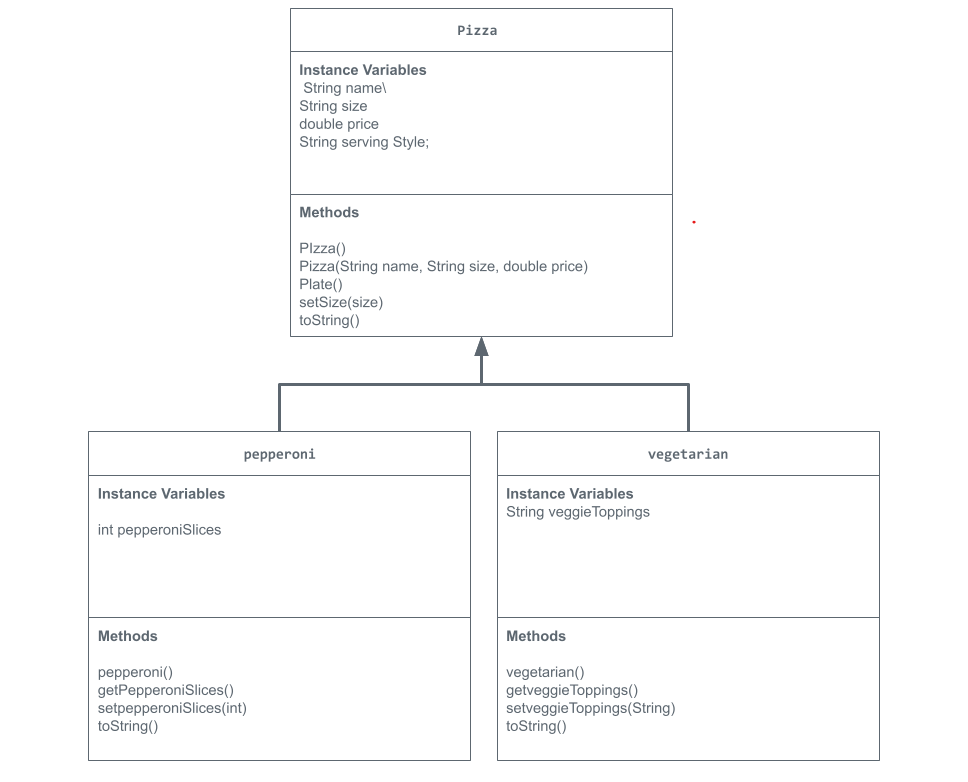

# Store-management-project
Pizza ordering UI APCSA project on JavaLab. 
# Unit 2 - Store Management Project

## Introduction

You are opening a new business in your community! Businesses often need programs to manage the products and services they offer and track orders and requests from customers. Your goal is to create a store management system for your business.

## Requirements

Use your knowledge of object-oriented programming and class structure and design to create your store management system:
- **Create a class hierarchy** – Develop a superclass that represents a product or service your business offers and one or more subclasses that extend the superclass to represent more specific types of products or services.
- **Declare instance variables** – Declare instance variables in the superclass that are shared with the subclasses and instance variables in the subclasses that are not shared with the superclass.
- **Write constructors** – Write no-argument and parameterized constructors in the superclass and subclasses. Subclass constructors use the super keyword to call the superclass constructor.
- **Implement accessor and mutator methods** – Write accessor and mutator methods for instance variables that should be accessible and/or modifiable from outside of the class.
- **Implement a toString() method** – Write toString() methods in the superclass and subclasses that return information about the state of an object.

## UML Diagram

Embed your UML Diagram here. Upload the image of your UML Diagram to your repo, then use Markdown to insert your image here:

## Description

1. Write a description of your project here. Include what your store you made, and why you chose this topic. In your description, include as many vocab words from our class to explain how you represented the item/service from your store. If you have user input, explain how the user will interact with your store such as which questions are prompted to the user, what response is your program expecting, and how that is used to output information for your store in the console.

My project is a pizza ordering system that allows customers to order pizza through a typed input. I chose this topic because pizza seemed like a very easy and convenient food to simulate at the time. My Pizza superclass stores instance variables shraed by every other class, but the pepperoni and vegtarian have their own unique variables while also extending them. I used class inheritance, argument and no argument constructors, mutator methods, and polymorphism to organize my program. Customers select whether they'll be eating in store or to go, the pizza type, and the toppings by clicking either 1, 2, or 3, and the program displays the order using toString(). 

2. How is this project related to STEAM (Science, Technology, Engineering, Art, and Mathematics)? Provide explicit examples from the project and details as possible. 

My projct relates to technology because I used computer programming and Java to create a user interactive pizza ordering system. It also relates to engineering because I had to plan and crate a UML and class hierarchy that organized the different pizza types. The designing of the menu and user experience also related to engineering. 

3. What SLOs did you demonstrate during completing this project?

I demonstrated my understanding of object-oriented programming by creating a class hierarchy through inheritance, superclasses, and subclasses. I used inheritance, argument and no argument constructors, extensions, super(), accessor methods, and mutator methods. I also incorporated user input, user interface, and condiitonal statements to make an interactive digital pizza ordering experience.  

